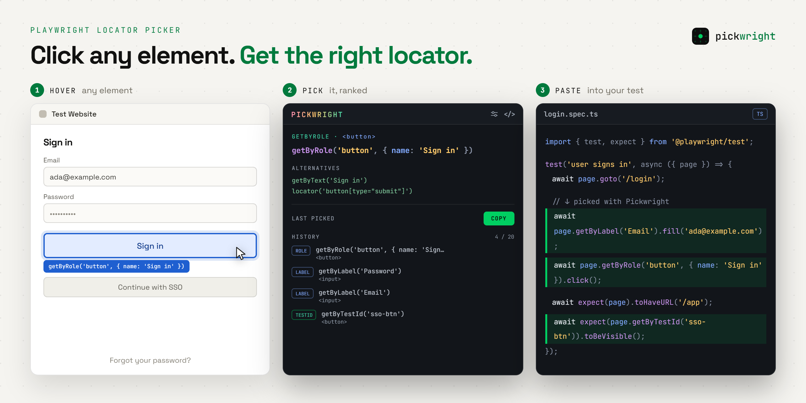

# Pickwright

  
  

Click an element on any page and get a Playwright locator, copied and ready to paste into your test. Works in Chrome, Edge and Firefox.

## Features

- Picks elements without triggering clicks or other page actions.
- Prefers `getByTestId`, `getByRole` and `getByLabel`, and falls back to CSS only when nothing better matches exactly one element.
- Skips auto-generated IDs and framework class names such as Angular's `mat-` and `cdk-`.
- Works inside open shadow roots and same-origin iframes, adding the `frameLocator()` chain for you.
- Multi-pick collects several elements in one session and copies them as one list.
- Keeps your last 20 picks, stored only in your browser.

## Install

- [Chrome Web Store](https://chromewebstore.google.com/detail/pickwright-playwright-loc/kgikopoehffaodbicnhajokkmhgjofjo) for Chrome and Edge
- [Firefox Add-ons](https://addons.mozilla.org/en-US/firefox/addon/pickwright/) for Firefox 140 or later

Manual install

Download the package for your browser from the [latest release](https://github.com/MithunWijayasiri/Pickwright/releases/latest).

**Chrome or Edge**

1. Unzip `pickwright-chrome-v<version>.zip` into a folder you will keep.
2. Open `chrome://extensions` (or `edge://extensions`).
3. Turn on **Developer mode**, click **Load unpacked**, and select the folder.

**Firefox**

1. Open `about:addons`.
2. Click the gear icon, then **Install Add-on From File**, and select `pickwright-firefox-v<version>.xpi`.

To build it yourself, see [Build from source](docs/build-from-source.md).

## Usage

1. Open the page you want to test.
2. Open the Pickwright popup and click **Pick element**, or press `Alt+Shift+L`.
3. Hover to highlight an element, then click it. Pickwright copies the best locator.
4. Reopen the popup to see alternatives and history.

**Pick multiple** keeps the picker on across clicks. Press **Stop picking** or `Esc` to finish, and Pickwright copies all picks as one list.

To open a dropdown or menu while picking, hold `Shift` and click. The page receives that click, and you can then pick inside the menu.

In settings you can turn off copy on pick, switch between light and dark themes, and set history to **Keep**, **Auto-clear** (wiped on browser start) or **Off**.

[Generated locator priority](docs/build-from-source.md#generated-locator-priority) lists the scoring order with examples.

## Troubleshooting

- **The picker doesn't start.** Reload the extension and refresh the page. Browser pages such as `chrome://` and the Chrome Web Store don't allow extensions.
- **The wrong element is picked.** Pickwright can't reach inside closed shadow roots or cross-origin iframes.
- **Nothing is copied.** Check the page console for Content Security Policy errors.

## Contributing

Open an [issue](https://github.com/MithunWijayasiri/Pickwright/issues) to discuss a change first. Then branch off `master`, follow [Build from source](docs/build-from-source.md) to set up, and open a pull request against `master`. CI runs lint and the E2E tests on every pull request.

AI-assisted contributions are welcome if you understand and have tested the change.

## Privacy

Pickwright sends nothing anywhere. History stays in the extension's local storage. See the [privacy policy](docs/PRIVACY.md).

## Support

If Pickwright saves you time, you can support it on [Ko-fi](https://ko-fi.com/mithunwijayasiri).

## License

MIT
